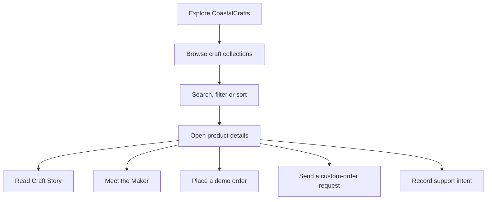
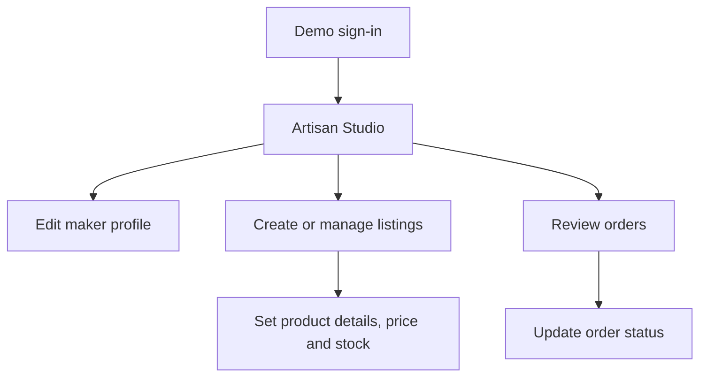

<div align="center">

# 🌊 CoastalCrafts
### Where coastal craft finds a wider shore.

**A craft-first marketplace celebrating the people, process, and products behind traditional crafts of coastal Karnataka.**

<br>


<br>

**DISCOVER A TRADITION** &nbsp; → &nbsp; **UNDERSTAND THE MAKING** &nbsp; → &nbsp; **CONNECT WITH THE MAKER**

</div>

---

## 🧵 The idea behind CoastalCrafts

A handmade piece is more than an item on a shelf. It carries materials chosen with care, techniques practiced over time, and knowledge shaped by a place and its people.

Yet traditional artisans in coastal Karnataka can struggle to build a digital presence and reach buyers beyond their immediate communities.

**CoastalCrafts explores a simple idea: a marketplace should help people discover the craft, understand the value behind its price, and meet the person who made it.**

This full-stack MVP provides a seeded local demo environment. Buyers can explore craft collections and products, while artisans can manage profiles and listings. Purchase, custom-order, and support actions demonstrate the intended experience without claiming to be a production-ready commerce service.

<div align="center">

| 🌿 DISCOVER | 🧶 UNDERSTAND | 🤝 CONNECT |
|:---:|:---:|:---:|
| Browse craft collections and products | Learn about the work behind a piece | Meet the maker and explore ways to engage |

</div>

## ✨ The MVP features


### 🛍️ 01 · Craft-first catalogue
- Browse **six seeded craft collections**.
- Search products, filter by craft and price, and sort by price.
- Open product detail pages.
- Home and collection pages can fall back to bundled sample data if the API is unavailable.

### 🧵 02 · Craft Story
Every product has the potential to tell a more meaningful story than its price alone. Optional product-level story fields can explain:
- Technique and process
- Materials used
- Time and skill involved
- Cultural or regional significance


### 👩🏽‍🎨 03 · Meet the Maker
Connect a product with the artisan behind it through maker and workshop profile details. This is an artisan-level story, separate from the story of an individual product.

### ✍️ 04 · Custom-order requests
Buyers can submit a request about a customised or made-to-order piece. Requests are saved locally in SQLite, but there is not yet an artisan-side request inbox or response workflow.

### 💛 05 · Support an Artisan
Record a contribution intent separately from a product purchase. The demo stores the amount in SQLite; **no money moves**.

</td>
</tr>
</table>

### 📦 06 · Demo product orders

The backend records an order and decrements product stock. Artisans can review associated orders and update their status.

**Boundary:** payment and fulfilment are not integrated. This is a local demonstration flow, not a live storefront.

### 🧑🏽‍💻 07 · Artisan Studio

Using a seeded demo account, an artisan can:
- Edit maker and workshop profile details.
- Create, edit, publish, save as draft, or remove product listings.
- Manage product stock.
- Review associated orders and update order status.

> **MVP note:** the current app does not include an artisan introduction-video feature. Craft Story fields are optional, so not every seeded product has story content. Custom-order requests can be recorded, but artisans cannot manage them in-app yet.

## 🪡 Two stories, two purposes

<div align="center">

| | **Craft Story** | **Meet the Maker** |
|:--|:--|:--|
| **Focus** | A particular product | The artisan |
| **What it shares** | Technique, materials, making time, skill, cultural context | Maker and workshop profile details |
| **Why it matters** | Helps buyers understand the work and value behind the price | Helps buyers connect the work to its maker |
| **In this MVP** | Optional product-level story fields | Profile details supported; no introduction video |

</div>

## 🧭 How it works

### Buyer journey



### Artisan journey



Custom-order requests are captured, but the artisan-side request-management workflow is not yet available.

## 🧱 Under the hood

At startup, the backend sets up the SQLite schema and seeds demo craft, product, and artisan records. The frontend calls the local API by default. Product/craft images and font references use remote URLs; the project does not configure a payment provider, authentication provider, or media-storage service.

### Technology stack

| Layer | Technologies |
|---|---|
| Frontend | React 18, JavaScript/JSX, Vite, React Router, CSS, Lucide React |
| Backend | Node.js, Express 5, CORS, dotenv |
| Database | SQLite through `better-sqlite3` |
| Development | npm, Nodemon |

### Project map

```text
Osco-2026/
├── README.md
├── backend/
│   ├── package.json
│   ├── package-lock.json
│   └── src/
│       ├── server.js               # Express app and API route mounting
│       ├── config/
│       │   ├── db.js               # SQLite connection and database path
│       │   ├── initDB.js           # Schema initialization
│       │   └── seedDb.js           # Demo records
│       ├── controllers/            # Craft, product, artisan, order, community logic
│       └── routes/                 # Express route definitions
└── frontend/
    ├── package.json
    ├── package-lock.json
    ├── vite.config.js
    ├── index.html
    ├── public/                     # Static public assets and icons
    └── src/
        ├── main.jsx                # React entry point
        ├── App.jsx                 # Application routes and artisan workspace
        ├── *.css                   # Global, marketplace, and artisan styles
        ├── assets/                 # Imported visual assets
        ├── components/             # Shared marketplace and artisan UI
        ├── data/                   # API client, route helpers, and sample data
        └── pages/                  # Marketplace, order, and artisan screens
```

---

## 🚀 Run CoastalCrafts locally

**Prerequisites:** 
- Node.js
- npm
- Git


### 1 · Clone the repository


```bash
git clone https://github.com/thushara-bajimar/Osco-2026.git 
cd Osco-2026
```

Open two terminals from the `Osco-2026` directory for the next steps.

### 2 · Start the API

```bash
cd backend
npm install
npm start
```

The API listens at `http://localhost:3000` by default. Visit `http://localhost:3000/` to see its health response.

### 3 · Start the web app

```bash
cd frontend
npm install
npm run dev
```
Open **http://localhost:5173** in your browser.

### 🔐 Demo Artisan Studio accounts

Go to `/artisan/login` and use either seeded account:

| Username | Password |
|---|---|
| `meenakshi-nayak` | `osco-demo` |
| `rukmini-shetty` | `osco-demo` |

These credentials are for local demonstration only. Do not reuse them for a deployed service.

### ⚙️ Optional configuration


## 🔌 API overview

Application endpoints are mounted below `/api` and exchange JSON.

<details>
<summary><strong>Expand API endpoint list</strong></summary>

| Method | Path | Purpose |
|---|---|---|
| `GET` | `/` | Backend health response |
| `GET` | `/api/crafts` | List crafts |
| `GET` | `/api/crafts/:id` | Read one craft |
| `GET` | `/api/products` | List published products |
| `POST` | `/api/products` | Create a product |
| `GET` | `/api/products/:id` | Read product details |
| `PATCH` | `/api/products/:id` | Update a product; optional `artisan_id` query parameter |
| `DELETE` | `/api/products/:id` | Delete a product; optional `artisan_id` query parameter |
| `POST` | `/api/artisans/login` | Check seeded demo credentials |
| `GET` | `/api/artisans/:artisanId/profile` | Read an artisan profile |
| `PATCH` | `/api/artisans/:artisanId/profile` | Update an artisan profile |
| `GET` | `/api/artisans/:artisanId/products` | List an artisan's products |
| `GET` | `/api/artisans/:artisanId/orders` | List an artisan's orders |
| `GET` | `/api/orders` | List orders |
| `POST` | `/api/orders` | Create an order |
| `GET` | `/api/orders/:id` | Read order details |
| `PATCH` | `/api/orders/:id` | Update order status; optional `artisan_id` in JSON body |
| `POST` | `/api/custom-orders` | Record a custom-order request |
| `POST` | `/api/support` | Record a support intent |

</details>


### 🔒 Security note

This repository is a development and demonstration project. Artisan passwords are stored in plain text, and the API does not enforce server-side authentication or authorisation for write operations. **Do not expose it to untrusted users or enter real payment details or sensitive personal information.**

## 🌱 Future Scope

These are future possibilities—not current MVP features:

- ✍️ **AI-assisted “Describe My Craft”** for product descriptions and craft stories.
- 🎙️ **Voice-based product listing** to make adding products easier.
- 🗺️ **Craft Map of Coastal Karnataka** to connect crafts with their places of origin.
- 💳 **UPI or payment-gateway integration** for real transactions.
- 📦 **Delivery tracking** for fulfilment visibility.
- ⭐ **Buyer reviews and ratings** to add post-purchase feedback.


## 📜 License

This project is currently developed as an educational and hackathon prototype.

---

<div align="center">

### 🌾 Every craft has a story. Every maker deserves to be seen.

**CoastalCrafts · Bringing craft, context, and maker closer together.**

</div>
